<div align="center">

# AegisVault


**An encrypted, local-first secrets vault you actually own: one file, no server,
no cloud.**

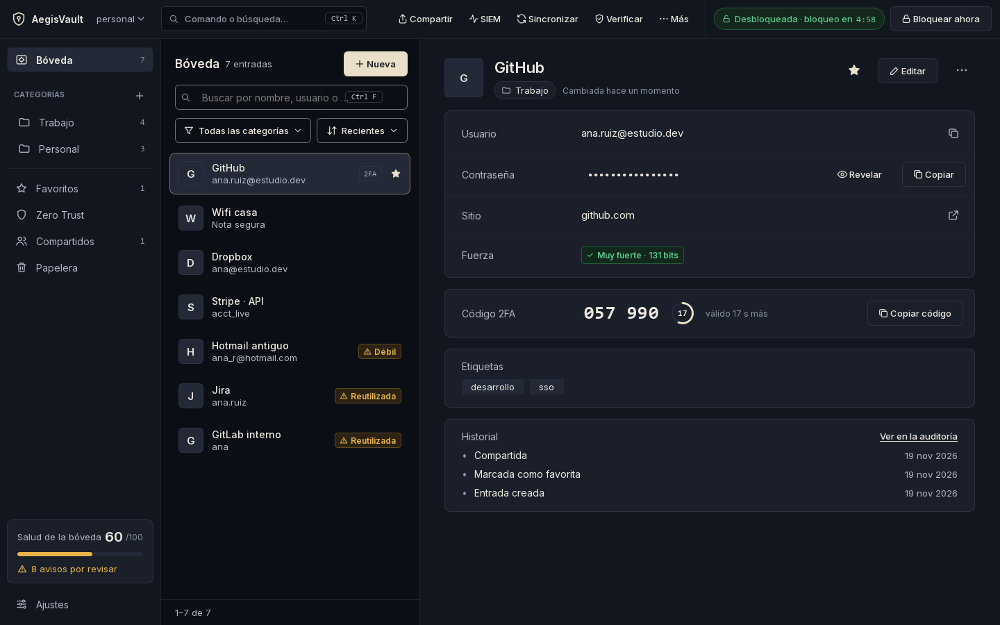

</div>

---

## At a glance

|  |  |
| --- | --- |
| **What it is** | A `1Password`/`pass`-style secrets manager where the vault is a file on your disk. GUI, CLI and a background agent are three thin adapters over one core. |
| **The one idea** | The master password never encrypts your data. It derives a key that **wraps** a random data key — envelope encryption, the pattern KMS and Vault use. Rotating the password rewraps that key; not a single secret is re-encrypted. |
| **Why two languages** | The domain is Python because that is where the rules live. The cryptography is a native Rust module — Argon2id, XChaCha20-Poly1305, `zeroize`. A pure-Python backend (Argon2id from `cryptography`, AES-256-GCM) keeps the app whole without a Rust toolchain: same port, different adapter. |
| **Losing the password** | Is survivable. Shamir K-of-N shares over GF(2⁸) reconstruct the key from any K of N, and the shares outlive password rotations. |
| **Tamper evidence** | Every action is a block in a SHA-256 chain. `verify` does not just say "broken" — it names the block where the chain breaks. |
| **Size** | 214 tests · strict hexagonal, domain with zero I/O |
| **Run it** | `pip install -e ".[gui]"` then `aegisvault-gui` · on Windows, one [`AegisVault.exe`](#windows-exe) |

**Contents** — [Screenshots](#screenshots) · [Architecture](#architecture) ·
[How a vault is sealed](#how-a-vault-is-sealed) ·
[Forgetting the master password](#forgetting-the-master-password) ·
[The audit ledger](#the-audit-ledger) · [What it does](#what-it-does) ·
[Install](#install-and-run) · [Windows .exe](#windows-exe) · [Workflows](#workflows) ·
[Status](#status)

---

## Screenshots

| | |
| --- | --- |
| 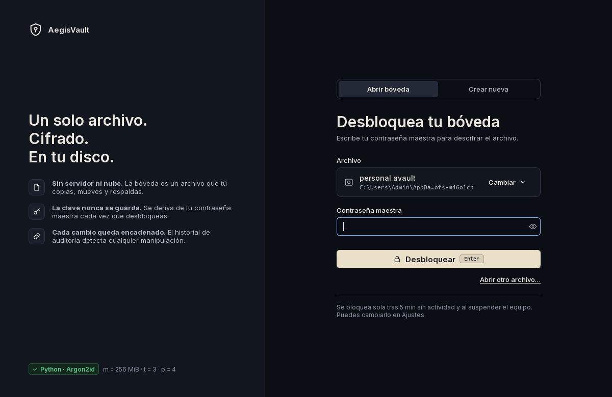<br>**Unlock.** The crypto profile is on show; from the fifth wrong password on, each try waits 30 seconds. | 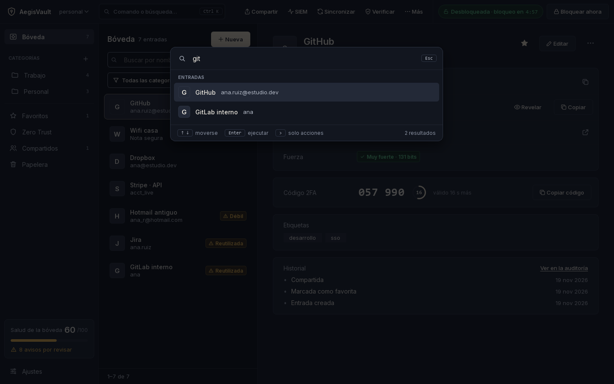<br>**Command palette.** `Ctrl K` finds entries and actions, ignoring case and accents. |
| 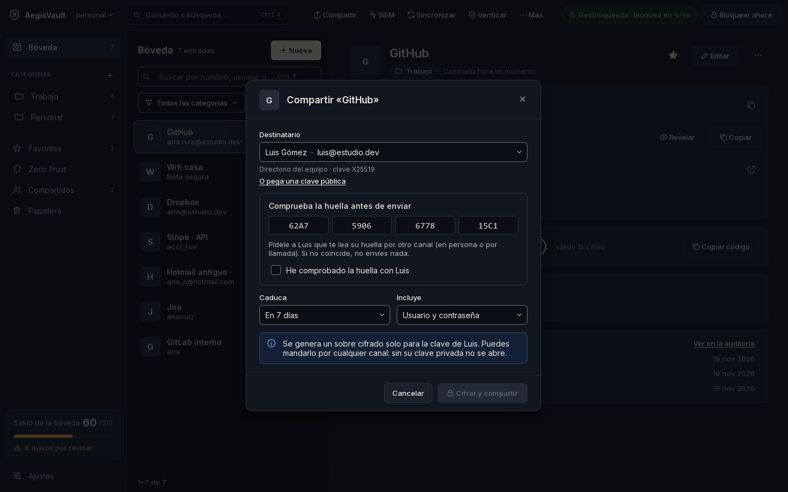<br>**Sharing.** Sealed to the colleague's X25519 key, once both of you have compared its fingerprint. | 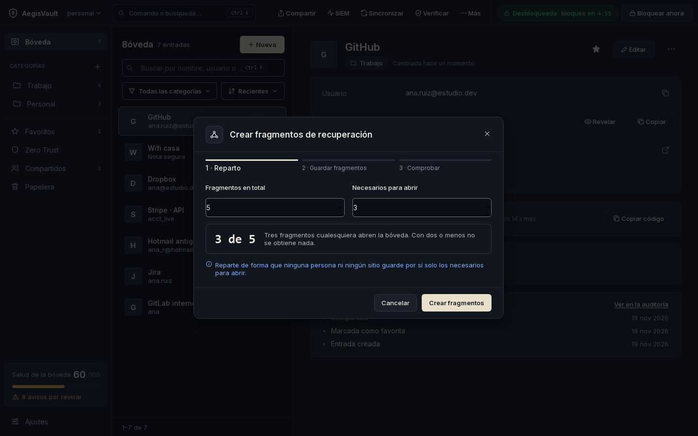<br>**Recovery.** Shamir shares: any K of N open the vault, fewer reveal nothing. |
| 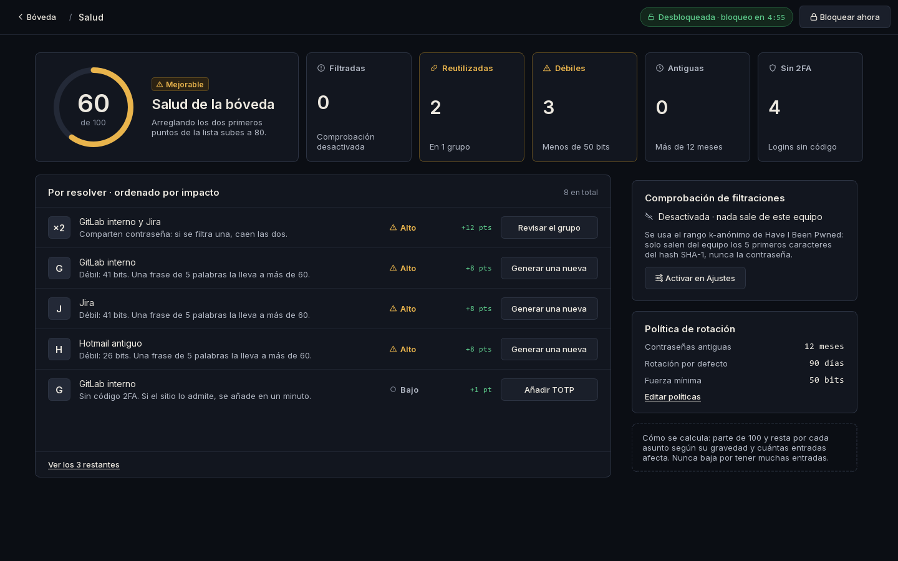<br>**Health.** Breached, reused, weak, old and 2FA-less logins, scored 0–100 and sorted by impact. | 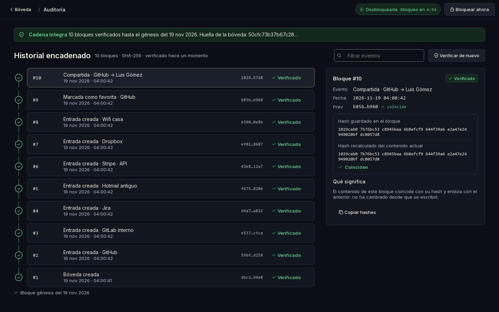<br>**Audit.** Every block re-hashed and linked to the one before it. |
| 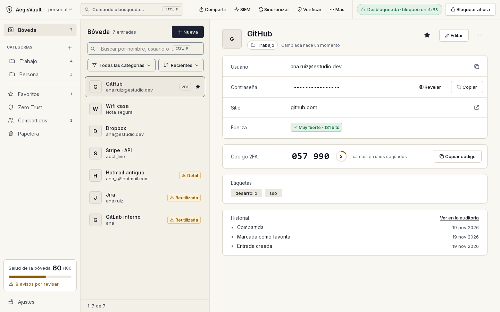<br>**Light theme.** Same layout, ink on ivory. | |

`python scripts/capture_screenshots.py` regenerates them offscreen from a throwaway vault
with made-up entries, so no real secret can end up in a picture.

---

## Architecture

Strict hexagonal. The domain has zero I/O, ports are `typing.Protocol`, and
`container.py` is the only place an adapter is ever wired. The GUI, the CLI and the
agent all drive the same core — none of them can reach storage or crypto directly.

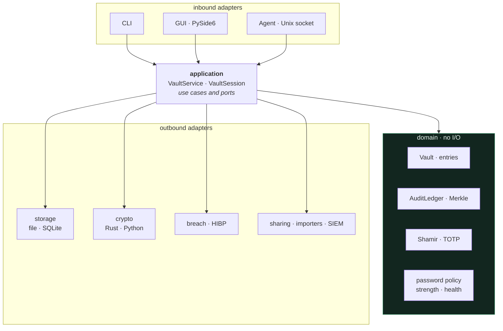

Two crypto adapters sit behind one port, and the vault records which one made it:

| Backend | KDF | AEAD | When |
| --- | --- | --- | --- |
| `ferrocrypto` (Rust, PyO3/maturin) | Argon2id | XChaCha20-Poly1305 + `zeroize` | Built and importable |
| Pure Python | Argon2id via `cryptography` (scrypt where OpenSSL lacks it) | AES-256-GCM | No toolchain needed; what the Windows `.exe` ships |

Argon2id runs with m = 256 MiB, t = 3, p = 4. Every build opens both Argon2id and scrypt
vaults; a vault sealed with XChaCha20 needs the Rust core, and a build without it says
so instead of failing.

---

## How a vault is sealed

The master password is never the key to your data. It is the key to the key.

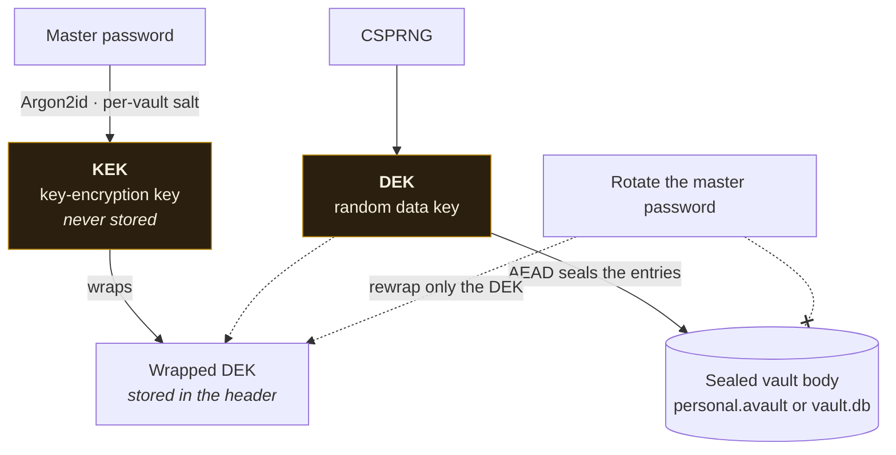

The consequence is the point: **rotating the master password rewraps one small key.**
The entries are never decrypted, re-encrypted or rewritten, so rotation costs the same
whether the vault holds ten secrets or ten thousand — and a crash mid-rotation cannot
corrupt the body, because the body is not touched.

Storage is a port with two adapters, chosen by the path you give it: an encrypted file
(any name; the desktop app suggests `personal.avault`) or SQLite (`.db` / `.sqlite`).
Both hold the same sealed artifact.

---

## Forgetting the master password

A local-first vault with no recovery is one forgotten password away from total loss.
Shamir secret sharing over GF(2⁸) splits the recovery secret into N shares of which any
K reconstruct it — and **K−1 shares reveal nothing at all**, which is the property that
makes it worth doing rather than just keeping a copy of the key somewhere.

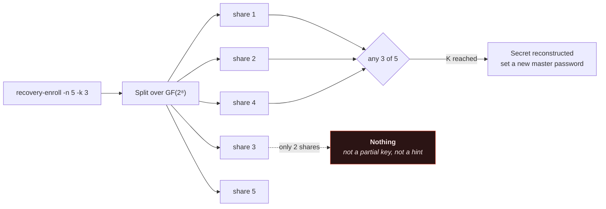

The shares survive password rotation: they recover the data key, and the data key does
not change when the password does.

---

## The audit ledger

Every action appends a block whose hash covers the previous one. Editing history means
recomputing every block after the edit — and `verify` walks the chain to find where it
stops matching.

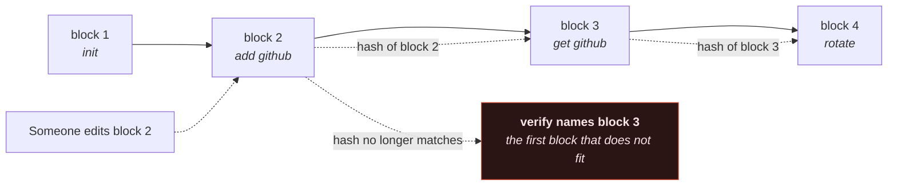

A Merkle root fingerprints the vault alongside it, and `audit-export` ships the chain to
a SIEM as JSON, CEF or syslog. `audit-stream` does the same live.

---

## What it does

**Core vault** — entry model with username, URL, category, tags, notes, favourites and
trash; password generator with an entropy-based strength meter; TOTP seeds with live
RFC 6238 codes in both GUI and CLI.

**Key management** — Shamir K-of-N recovery shares, master-password rotation.

**Integrity** — hash-chained audit ledger, Merkle-root fingerprint, SIEM export as
JSON/CEF/syslog, live stream.

**Security posture** — vault health report scoring weak, reused and 2FA-less credentials
0–100; HaveIBeenPwned breach check by k-anonymity, so only a 5-character SHA-1 prefix
ever leaves the machine; credential rotation report.

**Team** — public-key sharing that seals a secret to a colleague's X25519 key
(ECDH + HKDF + AES-GCM sealed box), with `share-list` and `share-revoke`; enterprise
roles, sensitivity levels and JIT access requests; import from Bitwarden, 1Password,
KeePass and generic CSV; encrypted backup, restore and sync bundles.

**Ops** — `aegisvault run --prefix FV_ -- <cmd>` injects entries as environment variables
into a subprocess, the way `doppler run` does; an ssh-agent-style Unix-socket daemon
serves `LIST`/`GET`/`CODE` with idle auto-lock.

**Desktop GUI** — PySide6 with the *Tinta y marfil* (ink and ivory) design in dark and
light, a Spanish interface, bundled Inter font and a keyboard-only focus ring. A splash
checks the crypto backend, the vault file and its header before the unlock screen, which
also creates vaults: a strong master password is required, and you confirm there is no
reset before the file exists. The typed password leaves the field the moment it is
submitted, guessing is throttled, and an unlock cancelled mid-derivation locks the
session it would have opened. Inside: the vault with categories, favourites, shared
items and trash; entry detail with reveal, copy and a live 2FA countdown; a command
palette (`Ctrl K`); the health dashboard; the audit history as a verified chain; sharing
with fingerprint checks; Shamir enrolment and restore; master-password rotation; SIEM,
sync, policy and access screens. The session locks on idle, screen lock and suspend, and
empties the clipboard if it holds something the app copied. `AEGISVAULT_THEME=light`
forces the theme and `AEGISVAULT_PROFILE_STARTUP=1` prints a startup profile.

---

## Install and run

```bash
git clone https://github.com/Zoel-Manchon/aegisvault && cd aegisvault
python3 -m venv .venv && source .venv/bin/activate
pip install -e . && pip install PySide6 cryptography

# optional but recommended — build the Rust crypto core first
cd rust && pip install -e . && cd ..

aegisvault --vault vault.fv init        # or vault.db for the SQLite backend
aegisvault-gui --vault vault.fv         # no --vault: the last vault, or create one
```

> A vault records the algorithms that sealed it: the Rust core seals with
> Argon2id/XChaCha20-Poly1305, pure Python with Argon2id/AES-256-GCM. Any build opens
> Argon2id and scrypt vaults, but an XChaCha20 vault needs the Rust core, so build it
> **before** `init` if you want it.

### Windows .exe

`scripts\build-exe.ps1` builds `dist\AegisVault.exe` with PyInstaller: one windowed
file of about 31 MB, nothing to install, no administrator rights. Each launch unpacks
Python and Qt into a private temporary folder, removed again on exit, so the window
takes a second or two to appear. Settings live in `%APPDATA%\aegisvault\settings.json`.

```powershell
py -m venv .venv
.venv\Scripts\python -m pip install -e ".[gui,dev]"
powershell -ExecutionPolicy Bypass -File scripts\build-exe.ps1
```

- **Check what you run.** The script prints the SHA-256 and writes it to
  `dist\AegisVault.exe.sha256`; compare it before trusting a copy someone sent you.
- **Crypto backend.** The build bundles whatever the environment has. Without the Rust
  core that is the Python backend (Argon2id, AES-256-GCM), which opens every vault
  except one sealed with XChaCha20 by a Rust build.
- **Unsigned.** The exe carries no code signature, so a downloaded copy gets a
  SmartScreen warning on first run.
- **Kept small on purpose.** No UPX packing (it trips antivirus heuristics); Qt Quick,
  Qt Network, software OpenGL and the TUIO touch plug-in, which listens on UDP, stay out
  of the bundle.

---

## Workflows

```bash
# daily use
aegisvault --vault v.fv add github --username zoel --category Dev --gen-totp
aegisvault --vault v.fv get github
aegisvault --vault v.fv code github                    # live 2FA code
aegisvault --vault v.fv list

# security posture
aegisvault --vault v.fv health --check-breaches
aegisvault --vault v.fv rotation-report --rotation-days 90
aegisvault --vault v.fv verify                         # audit chain + fingerprint

# recovery
aegisvault --vault v.fv recovery-enroll -n 5 -k 3      # 5 shares, any 3 recover
aegisvault --vault v.fv recovery-restore               # forgot the password
aegisvault --vault v.fv rotate                         # change the master password

# team sharing, public key
aegisvault share-keygen                                # your X25519 keypair
aegisvault --vault v.fv share prod-db --to <pubkey>
aegisvault --vault v.fv receive --key ferrovault_id.key --add prod-db

# devops
aegisvault --vault v.fv run --prefix FV_ -- ./deploy.sh
aegisvault --vault v.fv agent --timeout 300            # auto-locking secret daemon

# moving data
aegisvault --vault v.fv import --format bitwarden --file export.json
aegisvault --vault v.fv audit-export --format cef --out audit.cef
aegisvault --vault v.fv backup --out ~/Dropbox/vault.fv
```

---

## Status

```bash
pytest -q      # 214 passed, 3 skipped
```

The pure-Python crypto backend keeps the suite green with no Rust toolchain; the
Rust-specific tests activate on their own once `ferrocrypto` is built. The three skips
are the tests that need it.

Still open:

- **GitHub Actions CI** — pytest against the pure-Python backend, plus a maturin wheel
  build so the Rust path is covered too.
- **Signed Windows releases.** The `.exe` build is in place; what is missing is code
  signing and a release workflow that publishes it with its SHA-256.
- **Browser-extension autofill through the agent.** The agent already serves
  `LIST` / `GET` / `CODE` over its socket; what is missing is the extension and the
  native-messaging host that bridges it.
- **Passkey/WebAuthn unlock.** The seam is wired and the ceremony is not, and the code
  says so out loud: `DesktopPasskeyUnlockService` reports the platform authenticator and
  the GUI lists the enrolment steps, but `webauthn_ready` is `False` **on purpose**. A
  real unlock needs a device-bound credential store, challenge signing, account binding
  and a recovery path — and recovery shares stay mandatory before passkey-only unlock is
  ever allowed.

---

## License

MIT — see [LICENSE](LICENSE).
